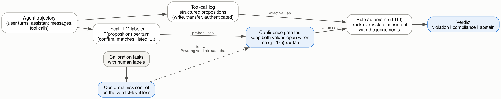

# Verdict-Level Risk Control for Neurosymbolic Runtime Monitoring of LLM Agents

[](LICENSE)


Code, labels and result files for the paper **"Verdict-Level Risk Control for Neurosymbolic Runtime Monitoring of
LLM Agents"** (Wentao Ma, Czech University of Life Sciences Prague; manuscript in preparation). Every number below is
produced by a script in this repository. Real-data results use the human-checked evaluation labels
(`data/labels_eval.csv`); their tables and figures are in `results/real_4B/` and `results/real_2B/`.

## Overview

LLM agents that act for users, such as cancelling an order or changing a flight, are given written policies:
*"before taking any action that updates the database, list the action details and obtain explicit user confirmation"*.
A promising way to check such rules splits the job in two. A language model reads each turn and answers simple
questions ("did the user explicitly confirm the listed action here?"), and a temporal-logic automaton combines the
answers into a verdict. When the language model misreads a turn, the verdict can be wrong without any sign of it.

This project makes the monitor say how often its verdicts are wrong, and abstain instead of guessing:

- each rule is an **LTLf formula** (linear temporal logic on finite traces) compiled to a small automaton over
  mutually exclusive step types;
- structured propositions (a write call, a transfer, a successful authentication) come from the tool-call log;
  linguistic propositions get a **probability from a local LLM**, asked only on the turns where they can hold;
- a judgement whose top probability is at most a **confidence gate tau** keeps both values open, and the monitor
  tracks every automaton state consistent with the judgements, returning *violation*, *compliance* or *abstain*;
- tau is chosen by **conformal risk control on a verdict-level loss** (1 exactly when the monitor commits to a wrong
  verdict), which is monotone in tau, so the expected rate of confident wrong verdicts on a new task is at most alpha.

<p align="center"></p>

## Main contributions

1. **A verdict-level loss for set-based monitors**, with a proof that it is monotone in the confidence gate, so
   conformal risk control bounds the rate of confident wrong verdicts at a level alpha chosen by the user. The loss
   hierarchy verdict <= state-relevant <= full coverage shows the usual coverage-style calibration as a more
   conservative special case.
2. **Per-rule and per-error-class budgets** (missed violations vs false alarms), with tasks as the exchangeable unit
   and the finite-sample floor alpha >= 1/(n+1) reported for every rule.
3. **Policy rules grounded verbatim in tau-bench**: eight rules with per-domain policy quotes, automata over
   mutually exclusive step types, and a confirmation-window semantics G(write -> Y(not user S confirm)) under which a
   write does not consume the confirmation.
4. **A labelled benchmark**: proposition-level human labels on public agent trajectories with versioned definitions
   and an adjudication record (6,266 judgements, all double-annotated: 835 pilot and 5,431 evaluation judgements).
5. **Negative and limiting results reported as such**: the method helps only when the hard-label error exceeds
   alpha and confident labeling errors are rare; calibrating propositions does not calibrate verdicts; and the
   verdict-level calibration applied to a frontier LLM judge matches the automaton with a 4B labeler and beats it
   with a 2B labeler.

## Key results

| Question | Finding | Data | Where |
|---|---|---|---|
| Do the automata implement the formulas? | Every automaton agrees with a reference LTLf semantics on all traces of up to five or six steps. | exhaustive | `tests/test_core.py` |
| Does the guarantee hold in simulation? | The rate of confident wrong verdicts stays below alpha at every level tested (100 fresh calibration/test draws per level). | simulation | `experiments/sim_sweeps.py` |
| When does the method help? | At alpha = 0.10, coverage-style calibration abstains on 73 % of trajectories once 1 % of judgements are confidently wrong; verdict-level calibration abstains on 7-27 % up to a 5 % rate and collapses at 10 %. | simulation | `experiments/sim_sweeps.py` |
| Can humans agree on the propositions? | Pilot: two annotators on 835 judgements, Cohen's kappa 0.84. Evaluation: an independent second annotator on all 5,431 judgements, 98.5 % agreement, kappa 0.936 (confirm 0.907, matches_listed 0.847). | pilot, evaluation | `data/labels.csv`, `data/labels_eval_annotator2.csv` |
| Can AI agents pre-annotate? | Agreement with the adjudicated pilot labels 98.9 % and 98.5 % for two agents. On the evaluation set the human check changed 24 of 5,431 pre-labels, all among the 36 that two agents disagreed on. | pilot, evaluation | `experiments/compare_annotations.py`, `results/check.csv` |
| Is a small local labeler good enough? | Qwen3.5-4B answers confirm correctly in 80 % of user turns at a 0.5 cut-off, but only 0.2 % of its confirm judgements are wrong with confidence above 0.95. | evaluation | `experiments/label_quality.py` |
| Does the guarantee hold on real data? | Yes in all 58 rule, labeler and alpha settings (alpha 0.05 to 0.30; from 0.075 for R9, whose floor is 0.059): the mean rate of confident wrong verdicts over 200 task splits is at most alpha. | evaluation | `results/real_*/e2_alpha.csv` |
| Main comparison, R1 confirmation window (4B) | Hard labels are wrong on 15.8 % of trajectories. At alpha = 0.10: verdict-level calibration 8.0 % wrong, 14.3 % abstention; per-step conformal 7.3 % / 15.0 %; coverage-style 0.2 % / 39.9 %. | evaluation | `results/real_4B/e1_main.csv` |
| Is the difference from per-step conformal significant? | Not with 4B: abstention difference -0.6 points, 95 % interval (-10.9, +8.1). With 2B, yes: per-step conformal exceeds alpha = 0.10 in 100 % (R1) and 93 % (R9) of 400 paired repetitions, ours in 15 % and 18 %. | evaluation | `results/real_*/significance.csv` |
| Labeler size (2B vs 4B) | Qwen3.5-2B ranks worse on every proposition (pilot AUC 0.60-0.99 vs 0.80-1.00) but is rarely confidently wrong. On R1 at alpha = 0.10, verdict-level calibration keeps wrong verdicts at 6.6 % with 2B, at the cost of 63.5 % abstention. A weaker labeler costs abstention, not errors. | pilot, evaluation | `results/real_2B/e1_main.csv` |
| Is per-step calibration enough? | No: it calibrates judgements, not verdicts. With the 2B labeler at alpha = 0.10, per-step conformal is wrong on 30.1 % of R1 and 20.5 % of R9 trajectories; verdict-level calibration stays at 6.6 % and 5.8 %. | evaluation | `results/real_2B/e1_main.csv` |
| Does calibrating propositions calibrate verdicts? | No. On R1, Platt scaling halves the per-turn Brier score of confirm (0.136 to 0.067) but nearly doubles the trajectory Brier score of the probabilistic monitor (0.106 to 0.193). | evaluation | `experiments/e1_main.py` |
| Does the guarantee survive a domain shift? | No. Calibrating R1 on airline and testing on retail gives 18.1 % wrong verdicts with 4B at alpha = 0.10 (12.9 % with the second annotator's labels), while the label-free shift statistics barely move (abstention shift 0.002); with 2B the same shift is visible (abstention shift 0.114). | evaluation | `results/real_*/e6_shift.csv` |
| Do the results depend on who labelled? | No. With the second annotator's labels as ground truth every conclusion holds: the guarantee in all 58 settings, the 4B tie with per-step conformal, its failure with 2B (R1 29.7 %, R9 22.0 %), and the shift result (R1 airline to retail 12.9 % with 4B). Wrong-verdict rates move by at most 1.6 points. | evaluation | `results/real_*_annotator2/` |
| Is the automaton needed, or would an LLM judge do? | A frontier judge (GLM-5.3) reading the whole conversation breaks alpha on R1 when used alone (11.9 % wrong verdicts). With the same verdict-level calibration applied to its confidence it meets alpha on every rule. Against the automaton with the 4B labeler, no difference is significant in a paired test (R1 abstention 7.0 % vs 14.3 %, 95 % interval of the difference -3.5 to +16.7 points); the automaton tends to be better on R4 and runs on a laptop. Against the 2B labeler, the calibrated judge abstains significantly less. | evaluation | `results/real_judge/` |
| Where does the method add nothing? | R3, R4 and R9 (4B) already have hard-label error below alpha = 0.10, so calibration returns tau near 0; coverage-style calibration still abstains on 94 % of R9 trajectories. | evaluation | `results/real_4B/e1_main.csv` |

<p align="center">
<br>
<em>Simulation with fresh draws: (a) rate of confident wrong verdicts against the target alpha; (b, c) abstention and wrong verdicts at alpha = 0.10 as confident labeling errors become more common.</em>
</p>

## Installation

```bash
git clone https://github.com/witold-andelie/nesymon.git
cd nesymon
python3 -m venv .venv && source .venv/bin/activate
pip install -e ".[dev]" mlx-lm        # numpy, pandas, matplotlib, pyyaml; pytest; MLX for the local labeler
python -m pytest -q
```

Python 3.11 was used throughout. The local labeler runs with MLX (mlx-lm 0.32.2) and needs Apple silicon; all other
steps run on any CPU. All numbers here were produced on an Apple M1 with 16 GB of memory.

## Data

The raw trajectories are not in the repository.

| Data set | Source | Licence | Used in |
|---|---|---|---|
| tau-bench historical trajectories: 1,980 conversations, retail (115 tasks) and airline (50 tasks), gpt-4o (4 trials per task) and sonnet-35-new (8 trials) | `git clone --depth 1 https://github.com/sierra-research/tau-bench.git data/raw/tau-bench` | MIT | everything |
| tau-bench policy documents (rule quotes) | same repository | MIT | `rules/rules.yaml` |
| Pilot labels: 835 judgements on 20 pilot tasks | this repository, `data/labels.csv` | Apache 2.0 | `e0_pilot`, `label_quality` |
| Evaluation labels: 5,431 judgements on 145 tasks (290 trajectories), human-checked | this repository, `data/labels_eval.csv` (review record `results/check.csv`) | Apache 2.0 | all real-data results |
| Second annotator's evaluation labels (independent) | this repository, `data/labels_eval_annotator2.csv`; the 83 disagreements are listed in `results/adjudication_eval.csv` | Apache 2.0 | agreement |
| Agent pre-labels of the evaluation set | this repository, `results/full_preannotation.csv` | Apache 2.0 | `compare_annotations` |

Pilot tasks are used only to tune the proposition definitions and are excluded from every evaluation. Annotation
sheets and labeler probability caches are generated locally (`data/README.md`) and are not stored here, because the
sheets repeat the conversation text.

## Reproducing the results

Run every command from the repository root.

| Result | Script | Command | Hardware (measured time) |
|---|---|---|---|
| Simulated guarantee and regime sweep, figure above | `sim_sweeps`, `readme_figures` | `python -m experiments.sim_sweeps`, `python -m experiments.readme_figures` | CPU |
| Toy comparison of the three calibration losses | `sim_toy` | `python -m experiments.sim_toy` | CPU |
| Data statistics, natural violations per rule and alpha floors | `data_stats`, `rule_counts` | `python -m experiments.data_stats`, `python -m experiments.rule_counts` | CPU |
| Annotation sheets (pilot, then evaluation) | `make_annotation_sheet` | `python -m experiments.make_annotation_sheet --tasks 10`, then without `--tasks` | CPU |
| Labeler probabilities | `run_labeler` | `python -m experiments.run_labeler --model mlx-community/Qwen3.5-4B-4bit` | M1, 16 GB (all 6,266 judgements: 4B 2.7 s each, about 4.7 h; 2B 1.46 s each, about 2.5 h) |
| Pilot gate and label quality | `e0_pilot`, `label_quality` | `python -m experiments.e0_pilot --probs <cache>`, `python -m experiments.label_quality --probs <cache>` | CPU (seconds) |
| LLM-judge baseline B1 (API) and its evaluation | `run_judge_api`, `e1_judge` | `python -m experiments.run_judge_api --url <OpenAI-compatible endpoint> --model glm-5.3`, then `python -m experiments.e1_judge --judge data/judge/glm-5.3.jsonl` | network (1,240 calls, about 1.5 h with 8 parallel requests) |
| All real-data experiments (E1, E2, E4, E6, E7, E8) | `run_all` | `python -m experiments.run_all --probs <cache> --labels data/labels_eval.csv --out results/real_4B` | CPU (about 15 min per labeler with the default 200 repetitions) |
| Blind double-annotation sample (20 % of evaluation tasks) and its agreement | `make_double_sheet`, `compare_annotations` | `python -m experiments.make_double_sheet`, then `python -m experiments.compare_annotations --pre <filled sheet> --labels data/labels_eval.csv --history /dev/null` | CPU |

`<cache>` is `data/probs/<model>.jsonl`, written by `run_labeler`. The labeler cache is append-only and keyed by
trajectory, step and proposition, so an interrupted run resumes where it stopped.

## Verification

- **Automata against formulas.** Each automaton is compared with a reference LTLf semantics with past operators on
  every trace up to the tested length, and each rule's pure-past form with its future form (`tests/test_core.py`).
- **Properties of the method.** Nested value sets, monotonicity of the verdict loss in tau, the loss hierarchy, the
  calibration threshold and its alpha floor, and the class-conditional budgets are unit-tested; a simulated pipeline checks the main table end to end (`tests/test_pipeline.py`).
- **Labeler cache.** Probabilities computed with the shared-prefix cache were compared with fresh model calls
  (largest difference 0.004). This check found that hybrid-attention models (Qwen3.5) cannot reuse a trimmed cache;
  all affected runs were deleted and recomputed.
- **Labels.** Human pilot labels were double-annotated and adjudicated; AI pre-annotations were scored against them on
  the held-out pilot before use, and one agent's share was cross-checked by another (`results/review_hy4_vs_codex.csv`).
  Every evaluation pre-label was then checked by a human reviewer (`results/check.csv`), and a second annotator labelled
  the whole evaluation set independently (`data/labels_eval_annotator2.csv`).
- **Statistics.** Results are averaged over repeated random task splits; intervals are task-level bootstrap intervals.

## Limitations

All trajectories come from one benchmark with simulated users and two agents, in two customer-service domains. The
guarantee holds in expectation over calibration draws, so a single calibration can exceed alpha (15 to 25 % of
repetitions here); a high-probability variant would need an upper confidence bound on the calibration risk. It is
also marginal over exchangeable tasks: it does not hold under a shift between calibration and use, and the
cross-domain result shows that label-free statistics do not always detect such a shift. Some rules have few
tasks (R9: 40 evaluation tasks, alpha floor 0.059 with a 40 % calibration split), and three of the five rules with
linguistic propositions have a hard-label error already below alpha = 0.10, where the method adds nothing. The
proposition definitions were tuned on the pilot tasks. The evaluation labels were checked by one reviewer starting
from agent pre-labels (24 of 5,431 changed) and labelled independently by a second annotator (kappa 0.936). The 83 disagreements were not adjudicated; instead
every experiment was rerun with the second annotator's labels as ground truth (`results/real_*_annotator2/`).

## Repository structure

```
nesymon/            the method
  core.py           automata over step types, value sets, online set monitor, losses, conformal risk control
  ltlf.py           reference LTLf semantics with past operators
  evaluate.py       task splits, pooled / two-sided / class-conditional calibration, metrics, bootstrap
  baselines.py      hard-label, raw-threshold, per-step conformal and LLM-judge baselines
  monitor_prob.py   probabilistic comparator (forward algorithm, temperature and Platt scaling)
  labeler.py        labeler prompt, yes/no probability, probability cache
  backend_mlx.py    MLX backend that reuses the shared conversation prefix
  data.py           tau-bench loader, structured propositions, label sites
  pipeline.py       labeling driver and assembly of monitor inputs
  inject.py         programmatic violation injection
rules/              rule registry with policy quotes (rules.yaml) and automaton templates (dfas.py)
props/              proposition definitions shared by the labeler prompt and the annotators
experiments/        simulations, data statistics, annotation, labeling, pilot gate, real-data experiments
data/               pilot and evaluation labels, adjudication record, agent pre-annotations (no raw data)
results/
  real_4B, real_2B  final tables (CSV) and figures for each labeler
  real_*_annotator2 the same with the second annotator's labels as ground truth
  real_judge        LLM-judge baseline with and without verdict-level calibration
                    plus pre-annotation files, review record (check.csv), simulation output
docs/
  theory.md         definitions, lemmas and proofs
  design_review.md  decision log: every design choice with its evidence and caveats
  framework/        OPM diagram of the project (DOT source and renderings)
  figures/          figures shown in this README
tests/              unit and property tests
```

Pre-annotation was done by AI agents working from `data/preannotation/INSTRUCTIONS.md` in separate folders that did
not contain the human labels; their raw outputs are kept separately per agent in `data/preannotation/`.

## Citation

The paper is in preparation; until it is published, please cite the repository as:

```bibtex
@unpublished{ma2026verdict,
  author = {Ma, Wentao},
  title  = {Verdict-Level Risk Control for Neurosymbolic Runtime Monitoring of {LLM} Agents},
  note   = {Manuscript in preparation; code at https://github.com/witold-andelie/nesymon},
  year   = {2026}
}
```

## License

The code and the labels are released under the Apache License 2.0 (`LICENSE`). The tau-bench trajectories and policy
documents are not redistributed here and remain under their MIT licence.

## Acknowledgements

The author thanks Professor Vojtěch Merunka (Faculty of Economics and Management, Czech University of Life Sciences
Prague) for his guidance on the Object-Process Methodology (OPM) framework. Trajectories and policies come from
tau-bench (Yao et al., 2024).
